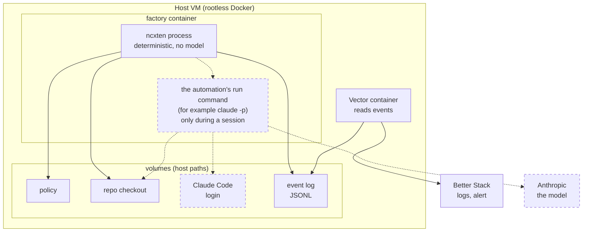
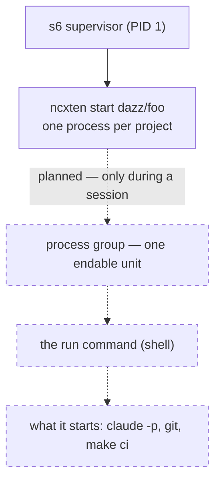
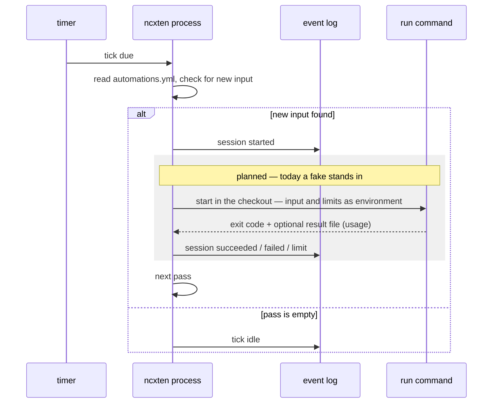
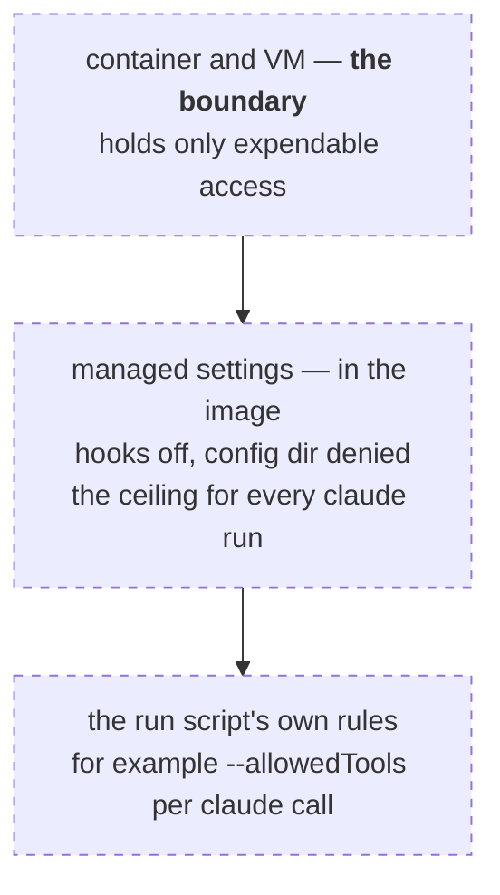
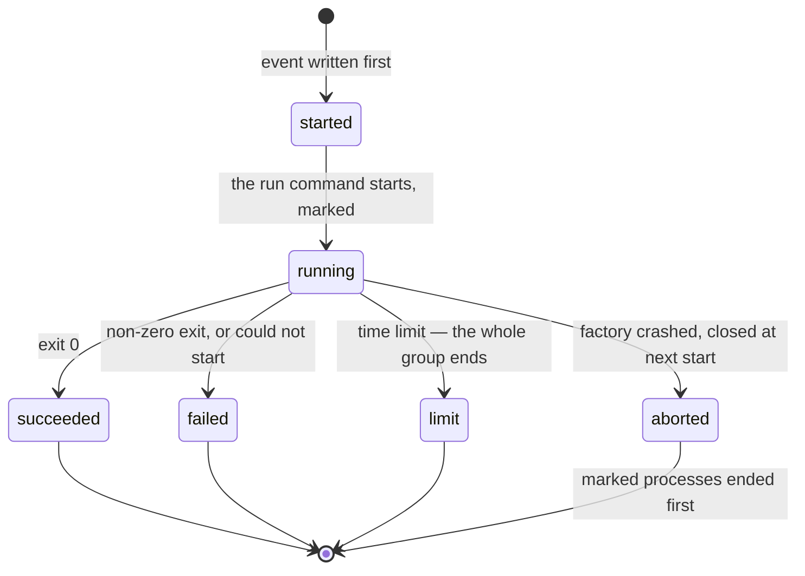

Six views of the same machine: where it runs, what runs inside, what one tick
does, who owns which file, what a session may do, and how a session ends.
Solid parts match the shipped code; dashed parts are **planned** and labeled
so. Unfamiliar words are in the [glossary](../glossary).

## Deployment

The `ncxten` process reads the policy, reads `automations.yml` from the
checkout and writes the event log. A session is the automation's own run
command, started in the checkout; what the command does there — project
zero's command makes a worktree and calls `claude -p` — is the repository's
own script, not the factory's business. Vector reads the events read-only
and ships them to Better Stack. The permission ceiling for agent runs
(managed settings) is baked into the image, not on a volume — no session can
edit it. Planned and not drawn: GitHub as the source of work.

## The process tree

The `ncxten` process is deterministic and has no model: it schedules, decides
and records. The session exists only while its run command runs, as leader of
its own process group, so the time limit can end the command *and* everything
it started. The model itself computes at Anthropic — nothing in the container
holds weights.

## One tick

Every event is appended and fsynced **before** the action it announces: the
log can claim more than happened, never less. The drain runs pass by pass —
one session per pass, first automation with new input wins — until a pass
finds nothing.

## Files and ownership

| file | where | written by | read by |
|---|---|---|---|
| policy | `<config-dir>/<owner>/<repo>.yaml` | you | `ncxten` at start and resume |
| `automations.yml` | default branch of the repository | you (via merge) | `ncxten`, every tick |
| event log | `<state-root>/events/<owner>/<repo>.jsonl` | `ncxten` only | `ncxten` (replay), Vector, you |
| pidfile + lock | `<state-root>/projects/<owner>/<repo>/ncxten.pid` | `ncxten` | the kernel (flock) |
| session output *(planned)* | `<state-root>/projects/<owner>/<repo>/sessions/<id>.out` | `ncxten` (live copy of the command's output) | you — kill cases included |
| result file *(planned)* | a path handed to the run command | the run command (optional: usage, cost) | `ncxten`, into the event |
| Claude Code login *(planned)* | a volume, `CLAUDE_CONFIG_DIR` | Claude Code | Claude Code |
| managed settings *(planned)* | `/etc/claude-code/managed-settings.json`, in the image | the image build | Claude Code, every run |

One writer per file is the rule everywhere: the event log has exactly one
writer (the lock holder), the policy is yours alone, and the managed settings
can only change with an image rebuild.

## What a session may do *(planned)*

The factory sets no rules for the run command itself — a command is a
command. What bounds a session, outermost first: the **container and its
VM**, which hold only expendable access — that is the v1 security boundary;
the image's **managed settings**, which every `claude` call in the container
loads and no flag can exclude (hooks off, config directory denied) — a
blanket permission bypass does not exist, Claude Code refuses it as root;
and the **run script's own rules**, such as an explicit allow list per
`claude` call. An allow list guards against accidents; it is **not a
security boundary**: an allowed gate such as `make ci` runs whatever the
Makefile says, and the session can edit that Makefile. What the factory
does enforce, for every command alike: the time limit ends the whole
process group, and the per-drain and per-day caps bound how often anything
runs. Isolation beyond the container comes later; the docs will not pretend
otherwise.

## A session's life *(planned)*

Every process a session starts carries the session's mark, so ending it —
at the time limit, or after a factory crash at the next start — is complete
only when nothing marked remains. What survives a session is whatever its
command committed to the repository, the full output on disk, and the log:
outcome, usage, cost. Today the lifecycle runs with a fake stand-in;
`limit` arrives with the real one.
