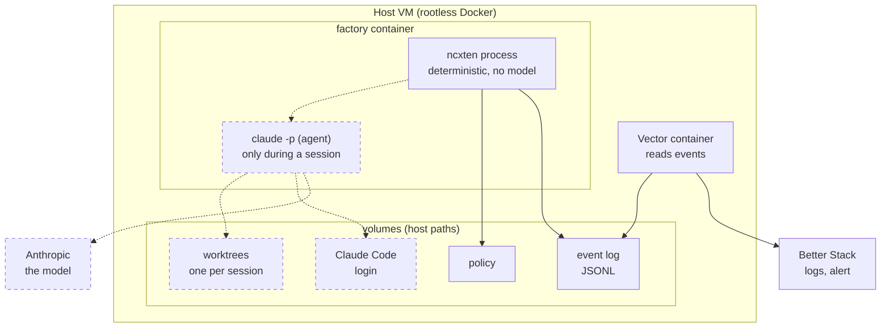
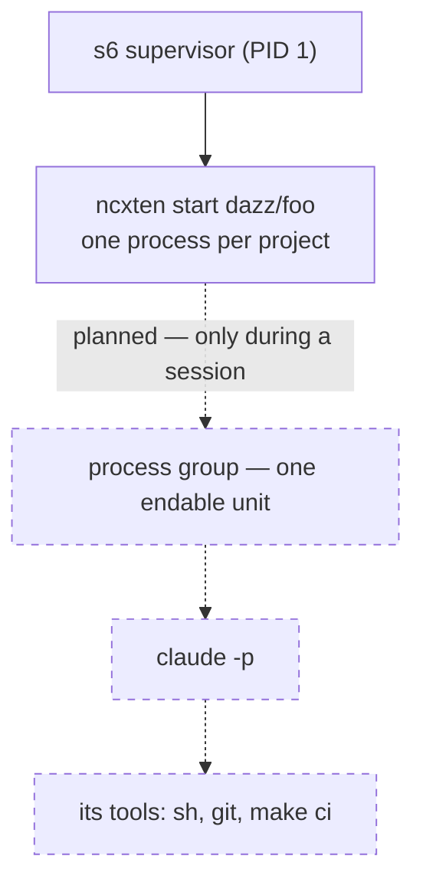
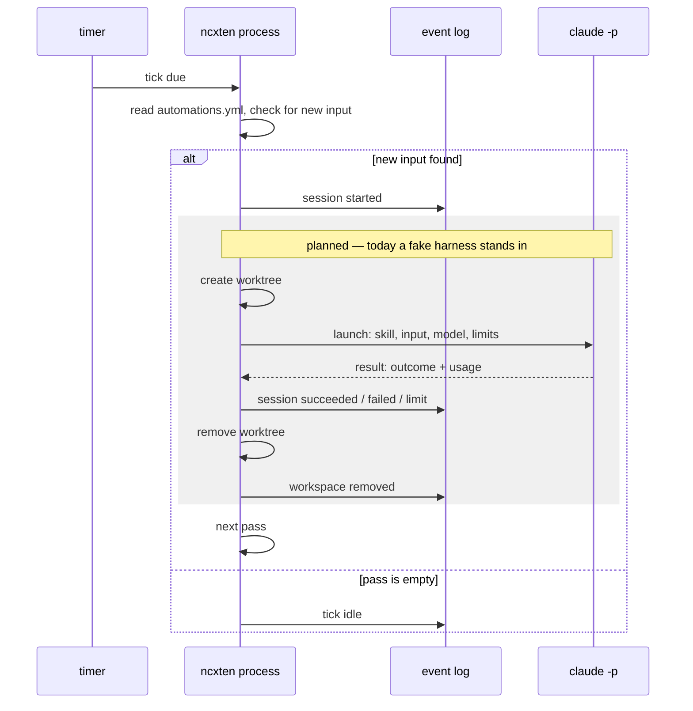
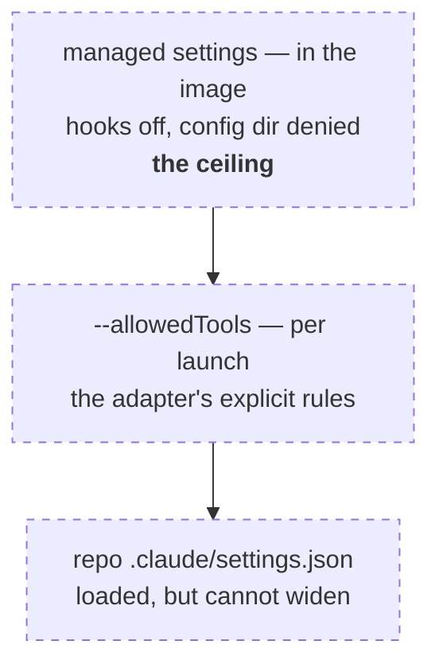
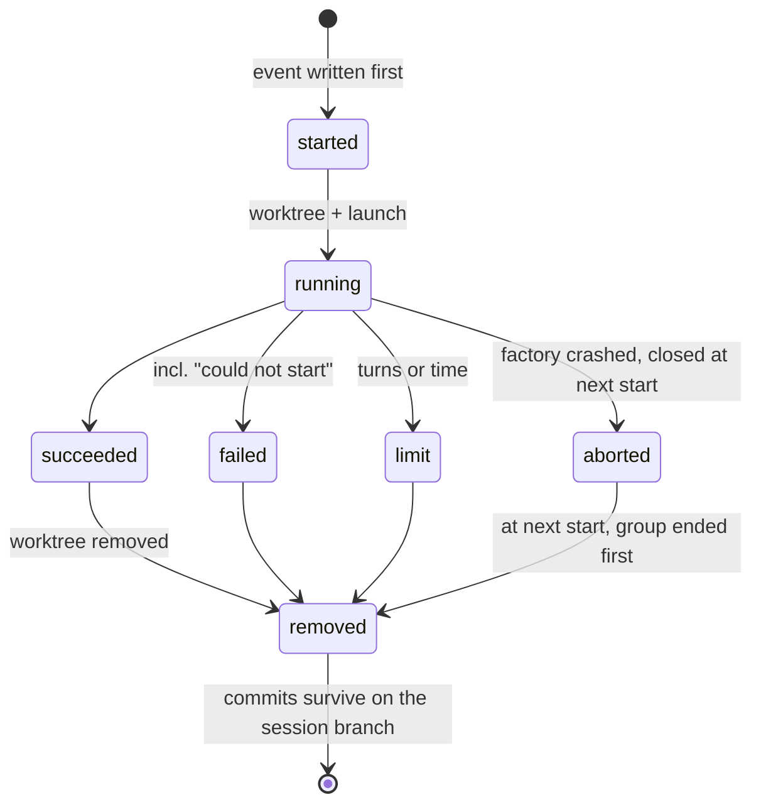

Six views of the same machine: where it runs, what runs inside, what one tick
does, who owns which file, what a session may do, and how a session ends.
Solid parts match the shipped code; dashed parts are **planned** and labeled
so. Unfamiliar words are in the [glossary](../glossary).

## Deployment

The `ncxten` process reads the policy and writes the event log; the agent
works only inside its worktree; Vector reads the events read-only and ships
them to Better Stack. The permission ceiling (managed settings) is baked into
the image, not on a volume — no session can edit it. Planned and not drawn:
GitHub as the source of work, and gate containers beside the factory
container.

## The process tree

The `ncxten` process is deterministic and has no model: it schedules, decides
and records. The agent exists only while a session runs, as leader of its own
process group, so the time limit can end the agent *and* everything it
spawned. The model itself computes at Anthropic — nothing in the container
holds weights.

## One tick

Every event is appended and fsynced **before** the action it announces: the
log can claim more than happened, never less. The drain runs pass by pass —
one session per pass, first automation with new input wins — until a pass
finds nothing.

## Files and ownership

| file | where | written by | read by |
|---|---|---|---|
| policy | `<config-dir>/<owner>/<repo>.yaml` | you | `ncxten` at start and resume |
| `automations.yml` | default branch of the repository | you (via merge) | `ncxten`, every tick |
| event log | `<state-root>/events/<owner>/<repo>.jsonl` | `ncxten` only | `ncxten` (replay), Vector, you |
| pidfile + lock | `<state-root>/projects/<owner>/<repo>/ncxten.pid` | `ncxten` | the kernel (flock) |
| worktrees *(planned)* | under the project's state directory | the session | nobody else — removed after the session |
| session branches *(planned)* | the checkout's `.git` | the session (commits) | you; later also GitHub |
| Claude Code login *(planned)* | a volume, `CLAUDE_CONFIG_DIR` | Claude Code | Claude Code |
| managed settings *(planned)* | `/etc/claude-code/managed-settings.json`, in the image | the image build | Claude Code, every session |

One writer per file is the rule everywhere: the event log has exactly one
writer (the lock holder), the policy is yours alone, and the managed settings
can only change with an image rebuild.

## What a session may do *(planned)*

Three layers, outermost wins: the image's managed settings disable all hooks
and deny the config dir; the adapter passes the explicit allow rules for this
launch; whatever the repository's own settings add on top has no effect — a
blanket permission bypass does not exist, Claude Code refuses it as root. The
allow list guards against accidents; it is **not a security boundary**: an
allowed gate such as `make ci` runs whatever the worktree's Makefile says,
and the session can edit that Makefile — the managed deny covers the file
tools, not commands the gate starts. The boundary in v1 is the container and
its VM, which hold only expendable access: the session runs as root in the
container, reads what the factory reads, and reaches the network through the
harness. Isolation beyond the worktree comes later; the docs will not
pretend otherwise.

## A session's life *(planned)*

Every exit path ends at the same place: the worktree is removed, forced if
dirty, and the removal is an event. What survives is on the session branch in
the checkout — and in the log: outcome, usage, cost. Today the lifecycle runs
with the fake harness and without worktrees; `limit` arrives with the real
one.
